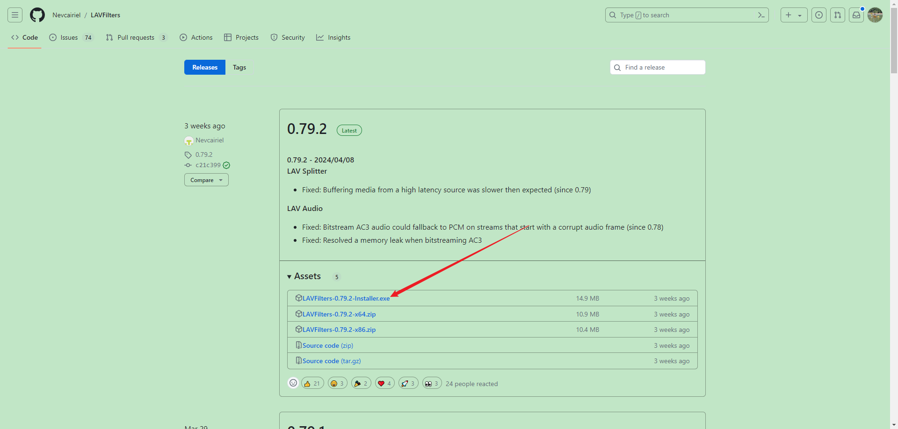
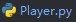

[](LICENSE)

# 多媒体播放器

## 简介

基于 PyQt5 的跨平台桌面多媒体播放器，支持图片浏览和视频播放，无需切换多个软件。视频播放功能附带截图和视频裁剪能力。

**适用平台**：Windows / macOS

## 功能特性

- **图片浏览**：支持常见图片格式的浏览与切换，含幻灯片播放
- **视频播放**：基于 OpenCV + PyQt5 的视频播放引擎
- **视频截图**：播放过程中一键截取当前帧
- **视频裁剪**：可视范围选择器，精确裁剪视频片段
- **私密模式**：独立私密库，与普通模式文件隔离，切换无痕
- **自定义 UI**：自定义标题栏、滑块组件、浮动控制面板
- **窗口记忆**：自动记忆窗口位置与大小

## 菜单栏

| 菜单 | 菜单项 | 快捷键 | 说明 |
|------|--------|--------|------|
| 文件(&F) | 退出(&Q) | `Ctrl+Q` | 关闭程序 |
| 视图(&V) | 普通模式 | — | 切换至普通模式（默认） |
| 视图(&V) | 私密模式 | — | 切换至私密模式 |
| 帮助(&H) | 关于(&A)... | — | 查看版本信息 |

> 「普通模式 / 私密模式」为互斥单选，同一时间仅激活一种模式。

## 私密模式

私密模式用于浏览不想在普通模式下暴露的媒体文件，与普通模式完全隔离：

1. 通过菜单 **视图 → 私密模式** 进入
2. 首次进入需点击 **「打开私密库」** 选择一个文件夹作为私密库根目录
3. 私密库路径保存在本地配置中，下次进入自动加载
4. 私密模式下左侧树仅展示私密库内的文件，普通模式的浏览记录不受影响
5. 可通过 **视图 → 普通模式** 随时切回

## 运行环境

| 依赖 | 版本要求 |
|------|---------|
| Python | 3.14+ |
| PyQt5 | 5.15.10 |
| OpenCV | ≥4.8.0 |
| NumPy | ≥2.0,<3.0 |
| Pillow | ≥10.4.0 |
| loguru | 0.7.0 |
| send2trash | 1.8.3 |
| apsw | — |
| pywin32 | —（仅 Windows） |

### Windows 解码器（必装）

LAVFilters 解码器是 Windows 下视频播放的必要依赖。请从 [LAVFilters Releases](https://github.com/Nevcairiel/LAVFilters/releases) 下载并安装：



或直接使用项目自带的安装包：`解码器/LAVFilters-0.73.1.exe`

## 快速开始

### 1. 克隆仓库

```bash
git clone <repo-url>
cd multimedia_player
```

### 2. 安装依赖

```bash
# Windows
pip install -r requirement.txt

# 国内用户建议使用清华镜像加速：
pip install -r requirement.txt -i https://pypi.tuna.tsinghua.edu.cn/simple --trusted-host pypi.tuna.tsinghua.edu.cn

# macOS
pip install -r requirement_mac.txt
```

### 3. 运行

```bash
python Player.py
```

或双击 `Player.py` 文件运行：



## 构建打包

使用项目自带的构建脚本一键打包：

```bash
# Windows — 完整构建（目录版 + 单文件版 + ZIP 归档 + GitHub Release）
scripts\build.bat

# 仅构建不推送 Release
scripts\build.bat norelease

# 仅构建目录版（启动快，适合本地调试）
scripts\build.bat onedir

# 仅构建单文件版（分发方便）
scripts\build.bat onefile

# 清理构建产物
scripts\build.bat clean

# 构建但不递增版本号（调试用）
scripts\build.bat nobump
```

构建脚本默认使用清华 pip 镜像加速下载。产物输出在 `dist/` 目录。

## 项目结构

```
multimedia_player/
├── Player.py                         # 应用程序入口
├── VERSION                           # 版本号唯一真源
├── requirement.txt                   # Windows 依赖
├── requirement_mac.txt               # macOS 依赖
├── src/
│   ├── data_manager/                 # 数据管理层
│   │   ├── config_manager.py         # 配置读写
│   │   ├── position_manager.py       # 窗口位置记忆
│   │   └── sqlite3_client.py         # SQLite 数据库客户端
│   ├── layout/                       # UI 组件层
│   │   ├── custom_slider.py          # 自定义滑块
│   │   ├── custom_title_bar.py       # 自定义标题栏
│   │   ├── floating_control_panel.py  # 浮动控制面板
│   │   ├── pic_input_layout.py       # 图片导入面板
│   │   ├── pic_show_layout.py        # 图片展示面板
│   │   ├── range_slider.py           # 范围选择滑块
│   │   ├── video_cut_thread.py       # 视频裁剪线程
│   │   └── video_show_layout.py      # 视频展示面板
│   └── utils/                        # 工具层
│       └── utils.py                  # 通用工具函数
├── scripts/                          # 构建与发布脚本
│   ├── build.bat                     # Windows 一键构建
│   ├── build_mac.sh                  # macOS 构建
│   ├── push_release.bat              # GitHub Release 推送
│   └── start.sh                      # 启动脚本
├── 解码器/                            # LAVFilters 安装包
└── img/                              # 文档配图
```

## 发布流程

1. 更新 `VERSION` 文件中的版本号
2. 运行 `scripts\build.bat` 完成构建（自动生成 onedir + onefile + zip）
3. 构建产物自动推送至 GitHub Release（需预先 `gh auth login`）
4. 也可单独推送：`scripts\push_release.bat`

## 许可证

This project is licensed under the MIT License - see the [LICENSE](LICENSE) file for details.

## 感谢

> This is an optional voluntary donation to support project development.
> Donation is NOT required to use this software and grants no commercial license.

如果这个工具帮到了您，欢迎随意赞赏，无论多少都是对我最大的鼓励！

